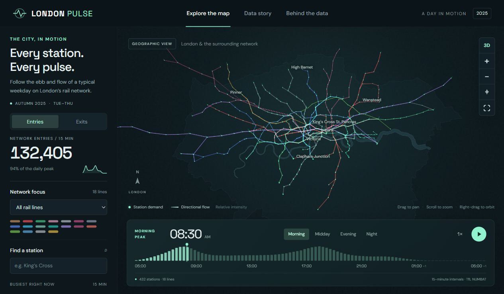
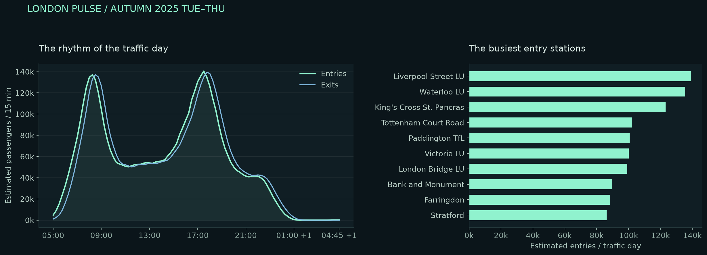

# London Pulse

**A day in motion.** A geographic Three.js experience that turns TfL's NUMBAT 2025 rail-demand workbook into an explorable, animated portrait of London.

Python owns the cleaning, validation and exploratory analysis. A small Vite application renders the prepared results with Three.js. The application runs without an API key, a backend or a live data service.



## Explore

- 432 active rail stations and 18 lines, placed at geographic coordinates.
- Directional GPU particles respond to estimated demand in 96 quarter-hour intervals.
- Timeline scrubbing, playback at three speeds, and morning / midday / evening / night presets.
- Station entries or exits, line focus, station search and station-level daily profiles.
- Orbit, pan, zoom, full-network view and a flat 2D view.
- A data story and methodology view that explain the source, findings and limits.
- Mobile layout, keyboard-accessible station search and controls, reduced-motion support, and a useful data interface if WebGL fails.

This is a **representative historical day**, not live trains. Animated particles communicate relative link demand, not individual passengers. Line filters select a line's links and served stations; station metrics still include all lines at those stations.

## Run the app

Requires Node.js 22.12 or later (Node 22 LTS recommended).

```bash
npm ci
npm run dev
```

Open the local URL printed by Vite. The committed `public/data/` snapshot lets anyone run the app immediately. No spreadsheet parsing happens in the browser.

```bash
npm test
npm run build
npm run preview
```

The output in `dist/` is a static site. Vite uses relative paths so it also works under a GitHub Pages repository subdirectory. Google Fonts enhance the typography when available; local sans-serif fallbacks keep the interface usable offline.

## Reproduce the Python analysis

Use Python 3.12. Place the original workbook at `data/raw/NBT25TWT_Outputs.xlsx`. It is intentionally ignored by Git; the prepared browser dataset and provenance are versioned.

```bash
python -m venv .venv
# Windows PowerShell: .venv\Scripts\Activate.ps1
# macOS / Linux: source .venv/bin/activate
pip install -r requirements.txt
python -m analysis.pipeline
python -m analysis.eda
python -m unittest discover -s tests -p "test_*.py"
```

Open **`notebooks/02_london_pulse_eda.ipynb`** in Jupyter or VS Code for the executed, narrated analysis. The existing `01_explore.ipynb` is preserved. The notebook can be rerun from the repository root or the notebooks directory.

The normal pipeline uses the versioned geographic reference and needs no network. To refresh external geography explicitly, run `python -m analysis.fetch_geography`, review coordinate changes, and rerun the pipeline. See [data provenance](DATA_PROVENANCE.md).

## Findings

The supplied workbook has approximately **5.18 million station entries** during the representative traffic day. Network entry demand peaks at **17:30–17:45**. The dataset contains 471 station records; 39 tram records have zero totals and are preserved but excluded from the active rail view.

Read the [Python EDA report](reports/EDA.md), [quality report](reports/quality_report.json), and [executed notebook](notebooks/02_london_pulse_eda.ipynb) for the evidence and limitations.



## Architecture

```text
TfL workbook + versioned geography
                 |
       analysis/pipeline.py
        pandas + NumPy + openpyxl
                 |
    validated tables + quality report
                 |
      public/data/network.json
                 |
       Vite + Three.js + GLSL
       interactive browser map
```

| Location | Purpose |
| --- | --- |
| `analysis/pipeline.py` | Import, clean, validate, join geography, export tidy data and JSON |
| `analysis/eda.py` | Python figures, analytical tables and written findings |
| `notebooks/02_london_pulse_eda.ipynb` | Executed exploration with rationale and outputs |
| `src/map.js` | Geographic scene, instanced stations, GPU flow particles and picking |
| `src/main.js` | Timeline, filtering, search, station details and narrative views |
| `reports/` | EDA, figures, quality checks and supporting CSV tables |
| `tests/` | Python domain tests and browser-data contract tests |
| `.github/workflows/` | CI and manually triggered GitHub Pages deployment |

## Data decisions

- Excel row 3 contains the real headers. The first two rows are presentation metadata.
- The line TOTAL row is excluded from line aggregation.
- Midnight belongs near the end of the traffic day, not its beginning.
- Entries, exits, boardings and passenger-segments remain distinct measures.
- Platform records use `(ID, Line)` keys. Ambiguous `Station_Flows` IDs are retained with source-row provenance and excluded from app metrics.
- Geographic joins use NLC codes. A documented source-code error is corrected for Headstone Lane. Custom House EL uses a labelled complex-location proxy.
- Estimated decimals are preserved in analysis; exported browser values are rounded to three decimals. No missing demand is imputed.
- Station size/height use square-root scaling against a fixed network maximum. Particle size and opacity encode demand, while speed is illustrative.

## Publish on GitHub Pages

1. Add this project to your GitHub repository, keeping `node_modules`, `dist`, and the raw workbook out of Git.
2. In repository **Settings → Pages**, choose **GitHub Actions** as the build source.
3. Run **Publish to GitHub Pages** from the **Actions** tab.

The deployment workflow is manual, and this project has not been pushed or published by the build process. CI tests the committed data contract and production build without needing the raw workbook. Reproducing the full analysis requires the original workbook.

## Attribution

Contains Transport for London open data. Station-coordinate reference: [Osakwe1 / TFL_Stations](https://github.com/Osakwe1/TFL_Stations). Thames and Greater London context: Greater London Authority. This is an independent portfolio project and is not an official TfL product. See [DATA_PROVENANCE.md](DATA_PROVENANCE.md) for source and reuse details.
