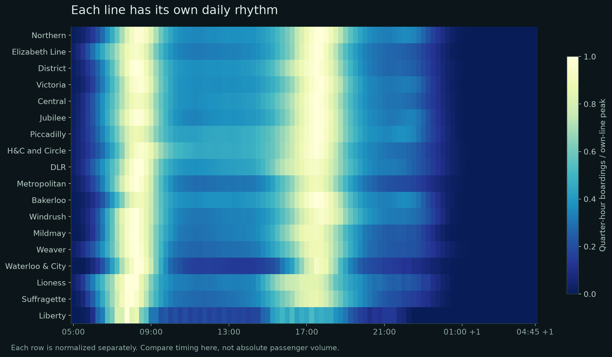

# London Pulse: exploratory findings

Source: user-supplied `NBT25TWT_Outputs.xlsx`, TfL NUMBAT 2025. TWT denotes a typical autumn Tuesday–Thursday. Traffic day: 05:00 to 04:59 next day. Figures describe one representative day, not annual totals.

## Findings

- **5,182,760 estimated station entries** and **5,186,806 exits** across the traffic day. The 4,047 difference is preserved, not forced to balance; the source does not establish its cause.
- **140,480 entries at 1730-1745**, the busiest quarter-hour.
- The ten busiest entry records account for **20.5%** of entries. Station complexes with multiple NLCs remain separate.
- **1.11×** as many entries in 16:00–19:00 as in 07:00–10:00.
- **Northern** has the most daily line boardings. Boardings include transfers and are not the same as entries or unique journeys.
- **432 active rail stations**, plus **39 zero-total tram records** preserved in the clean tables. Do not interpret the tram zeros as evidence that no passengers travelled.

## Cleaning and quality

The workbook's first two rows are presentation headers. Python reads row 3, removes empty formatting rows and the explicit line TOTAL, validates 96 ordered intervals, preserves numeric precision, and checks non-negativity and daily reconciliation (absolute tolerance 0.00001).

Station entry/exit NLCs and directed link IDs are unique. Station boarding/alighting records use **(ID, Line)**: platforms shared by lines legitimately repeat their ID. `Station_Flows` has **28 repeated ID occurrences** and **13 exact repeated rows** after trimming. These are retained with `source_excel_row`, reported as unresolved, and excluded from map metrics. No silent deduplication or demand imputation is performed.

All 471 station coordinates join after an explicit Headstone Lane code correction and one disclosed Custom House EL complex proxy. The reference's erroneous Headstone Lane 3186 is changed to 1434; Hayes & Harlington retains 3186 and its own location.

## Reading the figures

The heatmap normalizes each line by its own maximum. It supports comparisons of timing, not line volume. The station-peak balance table measures entries minus exits; a negative number indicates more exits in that period, not an identified commuting purpose.

## Limitations

NUMBAT estimates route choices using ticketing and gateline data and assumes full scheduled service. Interchange paths are less certain than non-interchange flows. Link totals count passenger-segments and cannot be summed to unique journeys. No capacity utilisation, live train position, delay, individual itinerary, causal explanation or annual trend can be inferred from this workbook alone. The browser rounds demand to three decimals for payload size and to whole estimates for display; analysis retains original precision.

See `quality_report.json` for sheet-level checks and `DATA_PROVENANCE.md` at the repository root for external geographic sources.
